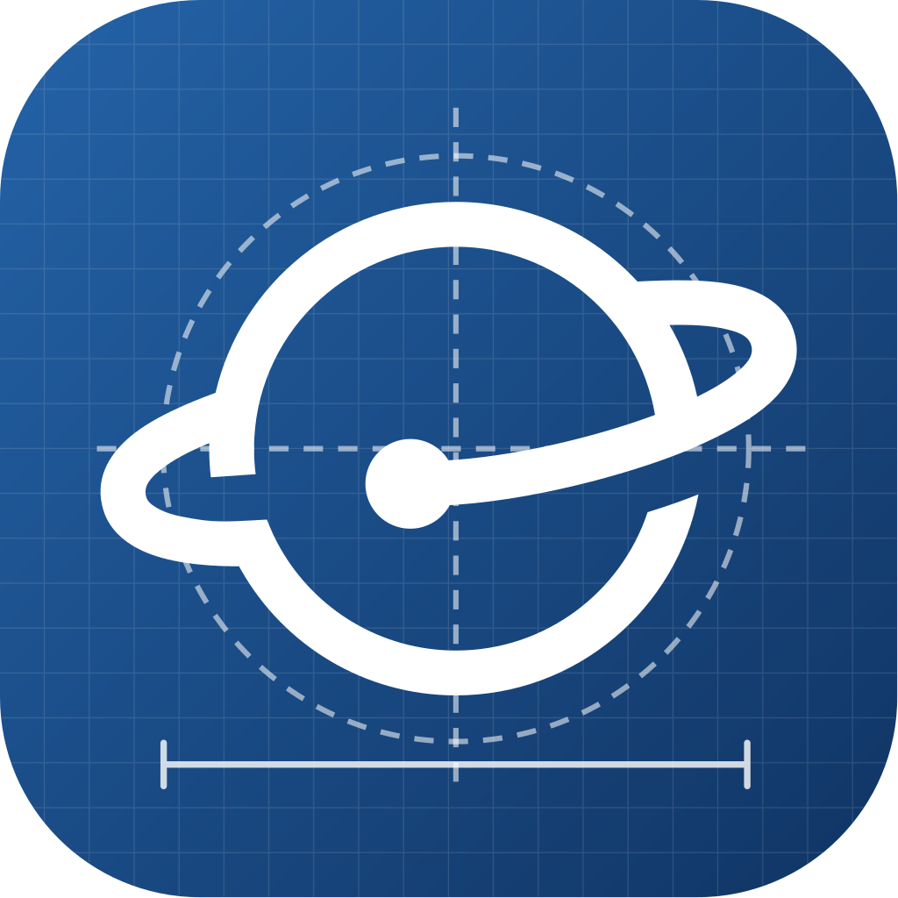
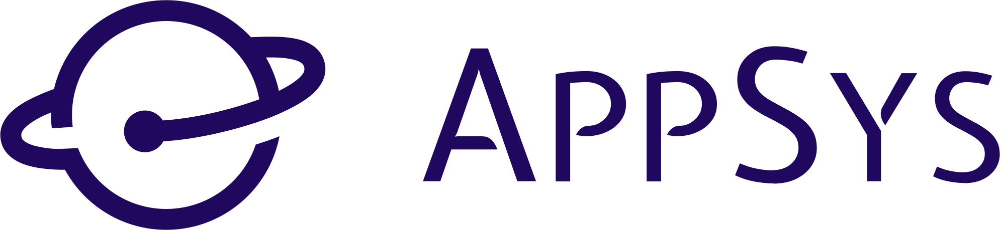

<div align="center">

<a href="https://appsys-sas.github.io/devtool/"></a>

# AppSys Devtool

**Your whole development stack, started from one YAML file.**

Terminals, HTTPS hosts, a shared development environment and permissions for coding agents,
in one local web interface.

[](https://github.com/AppSys-SAS/devtool/actions/workflows/ci.yml)
[](https://www.npmjs.com/package/@appsys-sas/devtool)
[](https://www.npmjs.com/package/@appsys-sas/devtool)
[](https://nodejs.org/)
[](https://www.typescriptlang.org/)
[](https://appsys-sas.github.io/devtool/agents/mcp-server)
[](https://appsys-sas.github.io/devtool/)
[](https://www.conventionalcommits.org/)
[](CONTRIBUTING.md)
[](LICENSE)

[Documentation](https://appsys-sas.github.io/devtool/) ·
[Getting started](https://appsys-sas.github.io/devtool/guide/getting-started) ·
[Configurator](https://appsys-sas.github.io/devtool/configuration/configurator) ·
[Contributing](CONTRIBUTING.md)

</div>

---

## Table of contents

- [Features](#features)
- [Install](#install)
- [Quick start](#quick-start)
- [Documentation](#documentation)
- [Built with](#built-with)
- [Contributing](#contributing)
- [Security](#security)
- [License](#license)
- [Trademark](#trademark)

## Features

- **One configuration** - Sections, projects, commands and services in a `config.yml` shared by the
  team, personal overrides in `config.local.yml`, split across files with `include`, with editor
  completion from a [JSON schema](https://appsys-sas.github.io/devtool/configuration/overview#editor-completion).
- **Real terminals** - Every command runs in a real terminal you can type into, search and restart. Its
  inputs are asked as buttons, dropdowns or free text when it starts.
- **HTTPS hosts** - A built-in load balancer serves `https://api.example.dev` from your local ports,
  with HTTP/2, WebSockets, a local DNS and certificates renewed by lego.
- **Shared environment** - Configuration files, databases (PostgreSQL, MariaDB, MongoDB), buckets and
  Redis pulled and pushed through the storage of your team (a CDN behind your OpenID Connect sign-in, S3,
  SFTP, git or your own scripts), with optional encryption on your machine.
- **Secrets on demand** - `{{ op://... }}`, `{{ file://... }}` and `{{ $(...) }}` value blocks read
  1Password, files and commands when a command starts, masked in its output.
- **Pull requests and issues** - GitHub and GitLab pull requests and issues of every repository, with
  their timeline, and buttons that hand them to a coding agent.
- **Coding agents** - A built-in [MCP server](https://appsys-sas.github.io/devtool/agents/mcp-server)
  lets Claude Code, Codex, Cursor and others run commands, read terminals and edit files, each action
  allowed, asked or denied by your configuration.

## Install

You need Node.js 24 or later, on macOS or Linux.

```bash
npm install -g @appsys-sas/devtool
devtool --version
```

or `pnpm add -g @appsys-sas/devtool`, `yarn global add @appsys-sas/devtool`, `bun add -g @appsys-sas/devtool`. The
package brings the `devtool` command, its server and its built interface; terminals use prebuilt binaries,
so nothing is compiled on your machine. Run the same command again to update.

## Quick start

Describe your projects in `~/.config/appsys/devtool/config.yml`:

```yaml
sections:
  acme:
    name: Acme
    path: acme
projects:
  web:
    section: acme
    default: { action: command:dev }
    commands:
      dev: { name: Vite, args: [ pnpm, dev ], startWithSection: true }
    services:
      web: { host: web.example.dev, target: 5173, tls: true }
```

Tell the devtool where your repositories live in `~/.config/appsys/devtool/config.local.yml`:

```yaml
workspace: ~/Workspace
```

Then start it and open <http://127.0.0.1:6730>:

```bash
devtool server
```

Not sure where to start? The [configurator](https://appsys-sas.github.io/devtool/configuration/configurator)
builds these files from forms.

## Documentation

| Page | What you find there |
|---|---|
| [Introduction](https://appsys-sas.github.io/devtool/guide/introduction) | what the devtool does and how it is organized |
| [Getting started](https://appsys-sas.github.io/devtool/guide/getting-started) | install, first configuration, first start |
| [Configuration](https://appsys-sas.github.io/devtool/configuration/overview) | every setting, explained with examples |
| [Environment](https://appsys-sas.github.io/devtool/configuration/environment/) | share files and databases with the team |
| [Agents](https://appsys-sas.github.io/devtool/agents/mcp-server) | connect a coding agent and decide what it may do |
| [CLI](https://appsys-sas.github.io/devtool/reference/cli) | every `devtool` command |

## Built with

The devtool stands on the shoulders of these open-source projects. Thanks to their authors and
contributors.

| Area | Projects |
|---|---|
| Interface | [Vue](https://vuejs.org), [Vue Router](https://router.vuejs.org), [VueUse](https://vueuse.org), [Vite](https://vite.dev), [Tailwind CSS](https://tailwindcss.com), [Reka UI](https://reka-ui.com), [shadcn-vue](https://www.shadcn-vue.com), [Lucide](https://lucide.dev), [Iconify](https://iconify.design) |
| Terminals and editor | [xterm.js](https://xtermjs.org), [node-pty](https://github.com/microsoft/node-pty) (prebuilt by [@lydell/node-pty](https://github.com/lydell/node-pty)), [Monaco Editor](https://microsoft.github.io/monaco-editor), [markdown-it](https://github.com/markdown-it/markdown-it), [DOMPurify](https://github.com/cure53/DOMPurify) |
| Server | [ws](https://github.com/websockets/ws), [YAML](https://eemeli.org/yaml), [Croner](https://croner.56k.guru), [dns-packet](https://github.com/mafintosh/dns-packet) |
| Agents | [Model Context Protocol TypeScript SDK](https://github.com/modelcontextprotocol/typescript-sdk), [Zod](https://zod.dev) |
| Environment | [AWS SDK for JavaScript](https://github.com/aws/aws-sdk-js-v3), [ioredis](https://github.com/redis/ioredis), [ssh2-sftp-client](https://github.com/theophilusx/ssh2-sftp-client), [xmldom](https://github.com/xmldom/xmldom), [toml-patch](https://github.com/DecimalTurn/toml-patch) |
| Sign-in and CLI | [oauth4webapi](https://github.com/panva/oauth4webapi), [Commander.js](https://github.com/tj/commander.js), [Inquirer](https://github.com/SBoudrias/Inquirer.js) |
| Documentation | [VitePress](https://vitepress.dev), [Ajv](https://ajv.js.org) |

## Contributing

Contributions are welcome. [CONTRIBUTING.md](CONTRIBUTING.md) explains how to run the devtool from
source, check a change and write commits.

## Security

The devtool is a development tool for the machine of a developer: **do not use it in production**.
[SECURITY.md](SECURITY.md) explains why, and how to report a vulnerability privately.

## License

Copyright 2026 AppSys SAS. Licensed under the [Apache License, Version 2.0](LICENSE).

## Trademark

AppSys is a registered trademark of AppSys SAS. The license covers the code, not the AppSys name or
logos: a fork may describe itself as based on the AppSys Devtool, but not use the name or logos for its
own product or suggest an endorsement by AppSys.

<div align="center">
<br>
<a href="https://appsys.digital"></a>
<br>
<sub>Made by <a href="https://appsys.digital">AppSys</a>: app development, infrastructure and European hosting.</sub>
</div>
